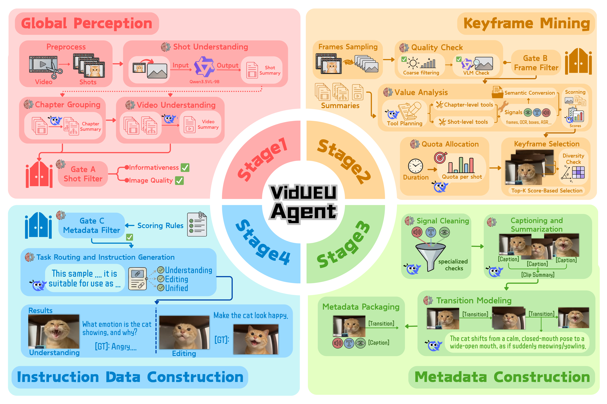

# VidUEU-Agent: A Data-Curation Agent for Multimodal Understanding, Editing, and Unified Tasks.

<p align="center">
  <strong>An agent pipeline for constructing evidence-grounded multimodal instruction data from videos.</strong>
</p>

<p align="center">
  <a href="https://arxiv.org/abs/2611.04418">Paper</a> |
  <a href="https://huggingface.co/datasets/Lruca/VidUEU100k">Dataset</a>
</p>

<p align="center">
  
</p>


## Table of Contents

- [VidUEU-Agent: A Data-Curation Agent for Multimodal Understanding, Editing, and Unified Tasks.](#vidueu-agent-a-data-curation-agent-for-multimodal-understanding-editing-and-unified-tasks)
  - [Table of Contents](#table-of-contents)
  - [Repository Structure](#repository-structure)
  - [Installation](#installation)
  - [Run the Pipeline](#run-the-pipeline)
  - [Run Auto-Iteration](#run-auto-iteration)
  - [Export](#export)
  - [Outputs and Data Format](#outputs-and-data-format)
    - [Metadata](#metadata)
    - [Instruction Data](#instruction-data)
      - [Understanding](#understanding)
        - [Fine-Grained Perception](#fine-grained-perception)
        - [Visual Reasoning](#visual-reasoning)
        - [Multi-Image Logic](#multi-image-logic)
      - [Editing](#editing)
      - [Unified](#unified)
        - [Grounded Edit-to-Select Generation](#grounded-edit-to-select-generation)
        - [Interleaved Understand-Recall-Generate-Select](#interleaved-understand-recall-generate-select)
        - [Stepwise Sequence Generate-and-Select](#stepwise-sequence-generate-and-select)
        - [Middle-Step Gap Generate-and-Fill](#middle-step-gap-generate-and-fill)
        - [Instructional Sequential Generate-and-Select](#instructional-sequential-generate-and-select)
  - [Citation and License](#citation-and-license)

## Repository Structure

```text
vidueu/                 Public CLI, configuration, export, and diagnostics
run_pipeline.py         Main pipeline entrypoint
orchestrator/           Pipeline stages and data iteration
executor/               Model, tool, and runtime components
configs/                Runtime and experiment configurations
manifests/              Model and asset manifests
scripts/                Setup, download, and process management scripts
tests/                  Regression and contract tests
docs/                   Configuration, output, and operation guides
```

## Installation

Clone the repository and enter it before running deployment:

```bash
git clone https://github.com/LRuca/VidUEU-Agent.git
cd VidUEU-Agent
```

Install the base pipeline，use:

```bash
bash deploy.sh
```


Auto-iteration needs BAGEL: install it with
```bash
bash deploy.sh --profile bagel
```

To install all profiles and their models in one command, use :

```bash
bash deploy.sh --profile all
```

Benchmark datasets and judge credentials are configured below. See `docs/installation.md` for mirrors and custom installation paths.


## Run the Pipeline

Copy the example to the repository root:

```bash
cp configs/pipeline.example.yaml pipeline.local.yaml
```

Edit these fields in `pipeline.local.yaml`:

| Fields | Set to |
| --- | --- |
| `input` | Your source video directory |
| `output` | A separate output directory for this run |
| `model_root` | Keep `./model` with the default deployment |
| `llm.base_url`, `llm.model` | Your text API endpoint and model |
| `vlm.base_url`, `vlm.model` | An available OpenAI-compatible vision endpoint and its served model name |
| `vlm.api_key_env` | Add the environment variable name if your vision endpoint needs authentication |

Relative pipeline paths are resolved against the configuration file.
Keep the remaining example fields for the default CPU tools/external VLM
preset. The vision service must already be running; downloading its weights
does not start it. Set `DEEPSEEK_API_KEY` in the launch shell for the default
text provider (or change `llm.api_key_env` to your provider's variable).

Start the pipeline in tmux with one command; readiness checks run before launch:

```bash
bash scripts/run_pipeline.sh --config pipeline.local.yaml --tmux
```

## Run Auto-Iteration

Copy the real-backend example to the repository root:

```bash
cp configs/iteration.example.yaml iteration.local.yaml
```

Edit these fields in `iteration.local.yaml`:

| Fields | Set to |
| --- | --- |
| `loop.candidate_pool` | Your labelled candidate JSONL with available images |
| `loop.output_root` | A separate directory for iteration state and results |
| `loop.pipeline_config` | `./pipeline.local.yaml`; also supplies the reflection LLM settings |
| `loop.rounds` | Number of feedback rounds; default `4` |
| `loop.target_train_samples` | Training-record target per round; default `30000`, not a video count |
| `bagel.visible_devices`, `bagel.nproc_per_node` | Explicit training GPU indices and matching process count |
| `bagel.total_steps`, `bagel.gradient_accumulation_steps` | Optimizer budget and gradient accumulation |
| `benchmark.commands` | Replace the marked paths/case IDs with your fixed benchmark subsets, media, adapters, and prompt/decoding definitions |


The example uses real BAGEL training, benchmark evaluation, and DeepSeek
reflection. Provide judge credentials through environment variables/key files
used by your adapters; do not embed keys in command arguments.
The three benchmark entries are MMDU, GEdit-Bench-En, and WEAVEbench.
Their adapter result contract is documented in `docs/iteration.md`.

Start the loop with one command:

```bash
bash scripts/run_iteration.sh --config iteration.local.yaml
```


## Export

Set `--output` to the completed, stopped run root
and `--destination` to a new directory outside that run. 
Export generated data and referenced images with one command:

```bash
./environments/pipeline/bin/vidueu export \
  --output outputs/run-001 \
  --destination outputs/package-001
```


## Outputs and Data Format

Export packages contain `understanding.jsonl`, `edit.jsonl`, `unify.jsonl`,
`metadata.jsonl`, referenced `images/`, and `manifest.json` for groups present.
Image paths are relative to the package root.

### Metadata

```text
{
  "segment": {
    "video_id": "<video ID>",
    "start": "<start timestamp>",
    "end": "<end timestamp>",
    "summary": "<segment summary>",
    "type": "<coarse label>"
  },
  "chapters": [
    {
      "chapter_id": "<chapter ID>",
      "time_span": ["<start timestamp>", "<end timestamp>"],
      "summary": "<chapter summary>",
      "role": "<chapter role>"
    }
  ],
  "shots": [
    {
      "shot_id": "<shot ID>",
      "chapter_id": "<chapter ID>",
      "time_span": ["<start timestamp>", "<end timestamp>"],
      "summary": "<shot summary>",
      "role": "<shot role>",
      "scene_type": "<scene type>",
      "quality_hint": "<image quality hint>",
      "info_hint": "<informativeness hint>"
    }
  ],
  "keyframes": [
    {
      "frame_id": "<frame ID>",
      "shot_id": "<shot ID>",
      "timestamp": "<frame timestamp>",
      "caption": "<frame caption>",
      "quality": "<quality judgment>",
      "value_score": "<value score>",
      "tool_semantics": "<tool-produced semantic signals>",
      "evidence_id": "<evidence ID>"
    }
  ],
  "transitions": [
    {
      "source": "<source frame ID>",
      "target": "<target frame ID>",
      "atomic_changes": ["<atomic visible change>"],
      "same_shot": "<whether the frames belong to the same shot>",
      "viewpoint_change": "<viewpoint change>",
      "subject_consistent": "<whether the main subject is consistent>",
      "reliability": "<reliability estimate>"
    }
  ]
}
```

### Instruction Data

#### Understanding

##### Fine-Grained Perception

```text
{
  "image_pos": <Frame[ID]>,
  "category": "presence|attribute|spatial|text|count",
  "question": "<single-image yes/no or multiple-choice question>",
  "options": ["<A>", "<B>", "<C>", "<D>"],
  "answer": "<Yes|No|A|B|C|D>",
  "evidence_refs": ["Frame[ID]_Caption", "Frame[ID]_Tool[ID]_Evidence"]
}
```

##### Visual Reasoning

```text
{
  "image_pos": <Frame[ID]>,
  "category": "reasoning|function|activity|relation",
  "question": "<why/how/what can be inferred from the image>",
  "answer": "<2-4 sentences grounded in visible cues>",
  "evidence_refs": ["Frame[ID]_Caption", "Frame[ID]_Tool[ID]_Evidence"]
}
```

##### Multi-Image Logic

```text
{
  "image_pos_list": [<Frame[ID]>, <Frame[ID]>, ...],
  "turns": [
    {
      "role": "user",
      "text": "Goal: <cross-image verification goal>.
       Plan: Step 1: <inspect Image1>. 
       Step 2: <inspect Image2>.
       Step 3: <compare them>.
       Images: Image1:<ImageHere> Image2:<ImageHere>.
       Step 1: <question>",
      "evidence_refs": ["Frame[ID]_Caption, ..."]
    },
    {
      "role": "assistant",
      "text": "<answer grounded in the referenced image>",
      "evidence_refs": ["Frame[ID]_Caption", ...]
    },
    {
      "role": "user",
      "text": "Step 2: <pairwise comparison question>",
      "evidence_refs": ["Frame[ID]_Caption", "Frame[ID]_Caption", ...]
    },
    {
      "role": "assistant",
      "text": "<cross-image answer>",
      "evidence_refs": ["Frame[ID]_Caption", "Frame[ID]_Caption", "Video_Summary", ...]
    }
  ]
}
```

#### Editing

```text
{
  "from_pos": <source Frame[ID]>,
  "to_pos": <target Frame[ID]>,
  "ok": true,
  "edit_count": 1|2,
  "edits": ["<atomic local edit>", ...],
  "instruction": "<local edit or infilling instruction>. 
                 Do not change anything else.",
  "reason": "<why the pair is small and controllable>",
  "evidence_refs": ["Transition[ID]", "Frame[ID]_Caption", "Frame[ID]_Caption"]
}
```

#### Unified

##### Grounded Edit-to-Select Generation

```text
{
  "Round_Plan": {
    "question": {
      "text": "What should be changed from the source image to reach the tar
      -get state?",
      "Frames": ["Frame[SOURCE_ID]", "Frame[TARGET_ID]"]
    },
    "answer": {
      "goal": "<objective target visual state>",
      "invariants": ["<stable entity/background>", ...],
      "edits": ["<grounded visible change>", ...]
    }
  },
  "Round_Gen": {
    "question": {
      "text": "Generate the target image after applying the grounded edit.",
      "Frames": ["Frame[SOURCE_ID]"]
    },
    "answer": {
      "image": "<generated target image>"
    }
  },
  "Round_Select": {
    "question": {
      "text": "Which candidate image best matches the generated target image?",
      "Frames": ["Frame[CANDIDATE_ID]", "Frame[CANDIDATE_ID]", ...]
    },
    "answer": "target:Frame[ID]",
    "rationale": "<why the candidate matches the generated target image>"
  },
  "evidence_refs": ["Frame[ID]_Caption", "Transition[ID]", ...]
}
```

##### Interleaved Understand-Recall-Generate-Select

```text
{
  "Round_Understand": {
    "question": {
      "text": "What visible facts describe the earlier and later image states?",
      "Frames": ["Frame[EARLIER_ID]", "Frame[LATER_ID]"]
    },
    "answer": {
      "facts": ["<visible earlier-state fact>", "<visible later-state fact>"]
    }
  },
  "Round_Plan": {
    "question": {
      "text": "What grounded visual changes connect the earlier state to the later state?",
      "Frames": ["Frame[EARLIER_ID]", "Frame[LATER_ID]"]
    },
    "answer": {
      "edits": ["<grounded earlier-to-later change>", ...]
    }
  },
  "Round_QA": {
    "question": {
      "text": "<open question about the recalled later detail>",
      "Frames": ["Frame[EARLIER_ID]"]
    },
    "answer": "<grounded later-state answer>",
    "rubric": ["<answer constraint>", ...]
  },
  "Round_Gen": {
    "question": {
      "text": "Generate the recalled later-state image.",
      "Frames": ["Frame[EARLIER_ID]"]
    },
    "answer": {
      "image": "<generated later-state image >"
    }
  },
  "Round_Select": {
    "question": {
      "text": "Which candidate frame matches the generated later-state image?",
      "Frames": ["Frame[CANDIDATE_ID]", "Frame[CANDIDATE_ID]", ...]
    },
    "answer": "target:Frame[ID]",
    "rationale": "<why the selected candidate matches the generated later state>"
  },
  "evidence_refs": ["Frame[ID]_Caption", "Transition[ID]", ...]
}
```

##### Stepwise Sequence Generate-and-Select

```text
{
  "Round_Overall": {
    "question": {
      "text": "What is the overall coherent visual sequence?",
      "Frames": ["Frame[START_ID]", "Frame[END_ID]"]
    },
    "answer": "<overall description of the visual sequence>"
  },
  "Round_Steps": {
    "question": {
      "text": "What are the grounded step-by-step state changes?",
      "Frames": ["Frame[STEP_0]", "Frame[STEP_1]", "Frame[STEP_2]", ...]
    },
    "answer": [
      "<step 1 grounded transition>",
      "<step 2 grounded transition>"
    ]
  },
  "Round_Gen": [
    {
      "question": {
        "text": "Generate the target image for step 1.",
        "Frames": ["Frame[STEP_0]"]
      },
      "answer": {
        "image": "<generated step-1 image >"
      }
    },
    {
      "question": {
        "text": "Generate the target image for step 2.",
        "Frames": ["Frame[STEP_1]"]
      },
      "answer": {
        "image": "<generated step-2 image >"
      }
    }
  ],
  "Round_Select": [
    {
      "question": {
        "text": "Which candidate frame matches the generated image for step 1?",
        "Frames": ["Frame[CANDIDATE_1]", "Frame[CANDIDATE_2]", ...]
      },
      "answer": "target:Frame[ID]",
      "rationale": "<why this frame is the correct step-1 state>"
    },
    {
      "question": {
        "text": "Which candidate frame matches the generated image for step 2?",
        "Frames": ["Frame[CANDIDATE_1]", "Frame[CANDIDATE_2]", ...]
      },
      "answer": "target:Frame[ID]",
      "rationale": "<why this frame is the correct step-2 state>"
    }
  ],
  "evidence_refs": ["Frame[ID]_Caption", "Transition[ID]", ...]
}
```

##### Middle-Step Gap Generate-and-Fill

```text
{
  "Round_Explain": {
    "question": {
      "text": "What visual state should fit between the earlier and later frames?",
      "Frames": ["Frame[EARLIER_ID]", "Frame[LATER_ID]"]
    },
    "answer": "<why the middle state fits between earlier and later frames>"
  },
  "Round_Gen": {
    "question": {
      "text": "Generate the middle-step image that fits between the earlier and later frames.",
      "Frames": ["Frame[EARLIER_ID]", "Frame[LATER_ID]"]
    },
    "answer": {
      "image": "<generated middle-state image >"
    }
  },
  "Round_Select": {
    "question": {
      "text": "Which candidate frame matches the generated middle-step image?",
      "Frames": ["Frame[CANDIDATE_1]", "Frame[CANDIDATE_2]", ...]
    },
    "answer": "target:Frame[ID]",
    "rationale": "<why the selected frame matches both adjacent transitions>"
  },
  "evidence_refs": ["Frame[A]_Caption", "Frame[B]_Caption", "Frame[C]_Caption",
                    "Transition[ID]", ...]
}
```

##### Instructional Sequential Generate-and-Select

```text
{
  "Round_Overall": {
    "question": {
      "text": "What future visual sequence should follow from the context frames?",
      "Frames": ["Frame[CONTEXT_1]", "Frame[CONTEXT_2]"]
    },
    "answer": "<overall future-step instruction from the context>"
  },
  "Round_Edit": {
    "question": {
      "text": "What visible edit should be made at each future step?",
      "Frames": ["Frame[CONTEXT_1]", "Frame[CONTEXT_2]"]
    },
    "answer": ["<step 1 edit instruction>", "<step 2 edit instruction>"]
  },
  "Round_Reason": {
    "question": {
      "text": "Why does each future step follow from the context or previous state?",
      "Frames": ["Frame[CONTEXT_1]", "Frame[CONTEXT_2]"]
    },
    "answer": ["<reason for step 1>", "<reason for step 2>"]
  },
  "Round_Target": {
    "question": {
      "text": "What visual state should each step reach?",
      "Frames": ["Frame[CONTEXT_1]", "Frame[CONTEXT_2]"]
    },
    "answer": ["<desired visual state after step 1>", "<desired visual state after step 2>"]
  },
  "Round_Check": {
    "question": {
      "text": "How can each generated future step be visually verified?",
      "Frames": ["Frame[CONTEXT_1]", "Frame[CONTEXT_2]"]
    },
    "answer": ["<visible condition for step 1>", "<visible condition for step 2>"]
  },
  "Round_Gen": [
    {
      "question": {
        "text": "Generate the target image for future step 1.",
        "Frames": ["Frame[CONTEXT_1]", "Frame[CONTEXT_2]"]
      },
      "answer": {
        "image": "<generated future-step-1 image>"
      }
    },
    {
      "question": {
        "text": "Generate the target image for future step 2.",
        "Frames": ["Frame[CONTEXT_1]", "Frame[CONTEXT_2]", "Frame[FUTURE_1]"]
      },
      "answer": {
        "image": "<generated future-step-2 image>"
      }
    }
  ],
  "Round_Select": [
    {
      "question": {
        "text": "Which candidate frame matches the generated image for future step 1?",
        "Frames": ["Frame[CANDIDATE_1]", "Frame[CANDIDATE_2]", ...]
      },
      "answer": "target:Frame[ID]",
      "rationale": "<why this frame is the immediate next future state>"
    },
    {
      "question": {
        "text": "Which candidate frame matches the generated image for future step 2?",
        "Frames": ["Frame[CANDIDATE_1]", "Frame[CANDIDATE_2]", ...]
      },
      "answer": "target:Frame[ID]",
      "rationale": "<why this frame matches the next future state>"
    }
  ],
  "evidence_refs": ["Frame[ID]_Caption", "Transition[ID]", ...]
}
```


## Citation and License

Original project code is licensed under [Apache-2.0](LICENSE).
If you use VidUEU-Agent or VidUEU data, please cite:

```bibtex
@inproceedings{vidueuagent,
  title     = {VidUEU-Agent: A Data-Curation Agent for Multimodal Understanding,
               Editing, and Unified Tasks},
  author    = {Anonymous Authors},
  booktitle = {NeurIPS},
  year      = {2026}
}
```
